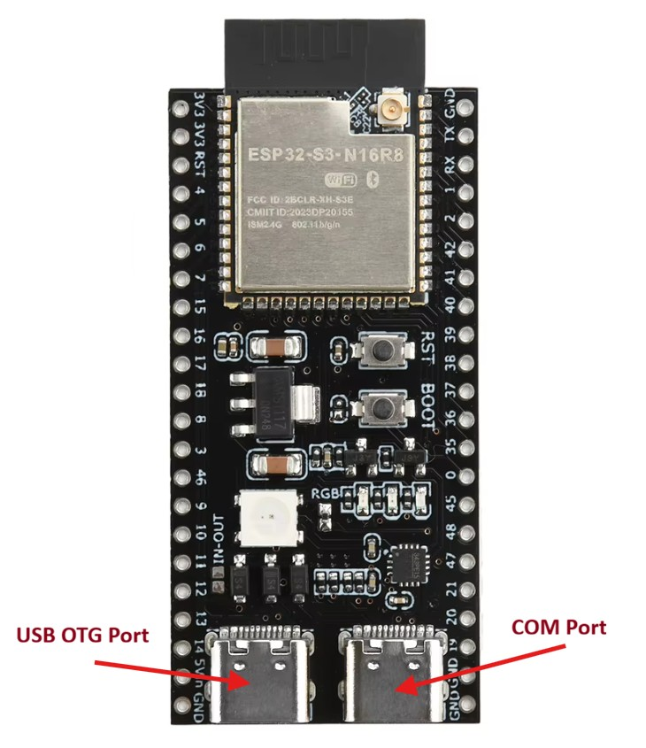
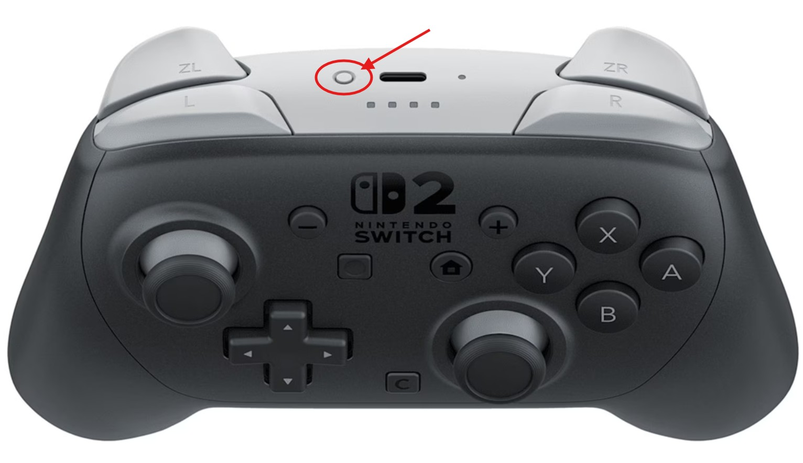

# ESP32-S3 Switch 2 Pro Controller Receiver

This firmware turns an ESP32-S3 board into a wireless receiver for the Nintendo Switch 2 Pro Controller. Connect the board to your Windows PC by USB, and your controller will appear as a PS5 (DualSense) controller.

It supports all the buttons, sticks, triggers, gyro, haptic feedback/HD rumble in compatible games, and battery level reporting. It does not support the 3.5mm headset jack.

## What you need

- A Nintendo Switch 2 Pro Controller.
- An ESP32-S3 DevKitC-1 **N16R8** board (16 MB flash, 8 MB PSRAM).
- A USB cable that supports data transfer.
- A Windows PC with Google Chrome or Microsoft Edge.

The board has two USB ports. Use the **COM/UART** port to install the firmware and the **USB/OTG** port for gameplay.

| Board port | Use it for |
| --- | --- |
| USB-to-serial, often labelled **COM** or **UART** | Installing the firmware |
| Direct USB, often labelled **USB** or **OTG** | Connecting the receiver to Windows for gameplay |



## 1. Download the firmware

Open this project's [Releases page](https://github.com/Yuge-Sun/Switch-2-Pro-Controller-Receiver/releases). Under the latest firmware release's **Assets**, download **`esp32s3-receiver.bin`**. This single file contains everything needed to flash the receiver. The **Source code** ZIP files are for developers.

If a release is not available, open the project's **Actions** tab, select a successful **Build release firmware** run, and download the **esp32s3-receiver** artifact at the bottom. Extract the ZIP to find the `.bin` file. GitHub requires you to sign in to download Actions artifacts.

## 2. Install the firmware

You can do this directly in your browser:

1. Connect the board's **COM port** to the PC.
2. Open [Espressif's web flasher](https://espressif.github.io/esptool-js/) in Chrome or Edge. Leave **WebUSB (CH340)** unchecked.
3. In the **Program** section, select baud rate **460800**, click **Connect**, and choose the board's USB serial device in the popup.
4. In the file row, set **Flash Address** to **`0x0`** and choose **`esp32s3-receiver.bin`**. Set **Flash Mode**, **Flash Frequency**, and **Flash Size** to **keep**.
5. Click **Program** and wait for it to finish. Keep the cable connected while it writes the firmware.
6. Click **Disconnect**, then unplug the board.

Installing this firmware clears the receiver's saved pairing and settings. Pair the controller again after each firmware update.

## 3. Pair and play

**For gameplay, move the cable to the board's USB/OTG port!**

1. Connect the board's **USB/OTG port** to your Windows PC. **Do not use the COM port for gameplay!**
2. **Hold** the controller's **SYNC/pairing button** until its player lights start cycling. The receiver will find and pair with it automatically. The button is circled in the picture below.

   

3. Once paired and connected successfully, Windows sees a **DualSense Wireless Controller**. Open your game and enable controller support if needed.
4. Configure the controller's audio device for **audio-driven rumble** in Windows. Press **Win + R**, type **`mmsys.cpl`**, and press **Enter** to open Windows Sound settings. In the **Playback** tab, select the receiver's **DualSense/Wireless Controller** speakers and click **Configure** at the bottom. Choose **Quadraphonic** (four speakers), then click **Next** until you reach **Full-range speakers**. Tick all available boxes, including **Front left and right** and **Surround speakers**, then click **Next** and **Finish**.

   **Check your default playback device:** the first time you connect the controller, Windows may automatically switch the default playback device to the controller's speakers. If this happens, select your own speakers or headphones in the **Playback** tab and click **Set Default** to restore your sound.

   Audio-driven rumble requires a game that supports DualSense haptics.

For everyday use, leave the receiver connected through its USB/OTG port and wake the controller with a button press. It reconnects automatically. After 10 minutes without input, the receiver disconnects the controller; press a button to resume. 

## If something goes wrong

- **The board is missing from the port list when trying to flash firmware:** check that you used the **COM** port and a data cable. Some charging cables might not support data transfer. You may need the board manufacturer's USB serial driver.
- **The flasher cannot connect:** close other programs that might be using the serial port. Hold the **BOOT** button on the board, press and release **EN/RESET**, then release **BOOT** and retry. If writing fails, try baud rate **115200**.
- **Flashing succeeds but Windows sees no controller:** connect using the board's **USB/OTG** port. Press **EN/RESET** once, and put the controller into pairing mode again. If you hear the USB connected sound repeatedly over and over again, it means the board has not been flashed correctly. Try flashing the board again with the **COM** port. Makes sure you've set the **Flash Address** to **`0x0`** in the flash tool.

## Why shows up as a PS5 controller?

Very few PC games natively support the Switch 2 Pro Controller. Presenting it as a DualSense lets you play with a wider variety of games that already support PlayStation controllers, while keeping gyro input and audio-driven haptics.

For games that expect an Xbox controller, Steam Input can translate the DualSense input into Xbox-style controls. It can also map the gyro to mouse movement or a stick, so gyro aiming remains an option even when a game has no native gyro support.

If the receiver used Xbox/XInput output instead, it would only expose buttons, sticks, triggers, and basic rumble, but no gyro data or DualSense haptic audio. Software could change the virtual controller's identity later, but it could not restore information the receiver never sent. PS5 mode keeps those features available, with Xbox-style controls as a software option when needed.

## For developers

Build from an activated [ESP-IDF 5.4.2 terminal](https://docs.espressif.com/projects/esp-idf/en/v5.4.2/esp32s3/get-started/index.html):

```text
cd firmware
idf.py set-target esp32s3
idf.py build
```

The GitHub Actions workflow also builds downloadable firmware on source changes and manual runs. 

## Credits and license

Based on [XinHeLianSheng-Pro2-Bridge](https://github.com/LeonChrome/XinHeLianSheng-Pro2-Bridge), using ESP-IDF, TinyUSB, and community Switch controller protocol research. Project code is licensed under [Apache-2.0](LICENSE); dependencies retain their own licenses. This project is independent of Nintendo and Sony.
